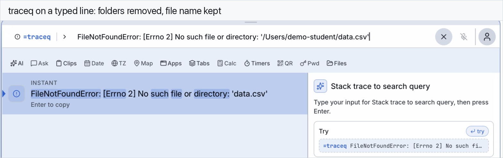
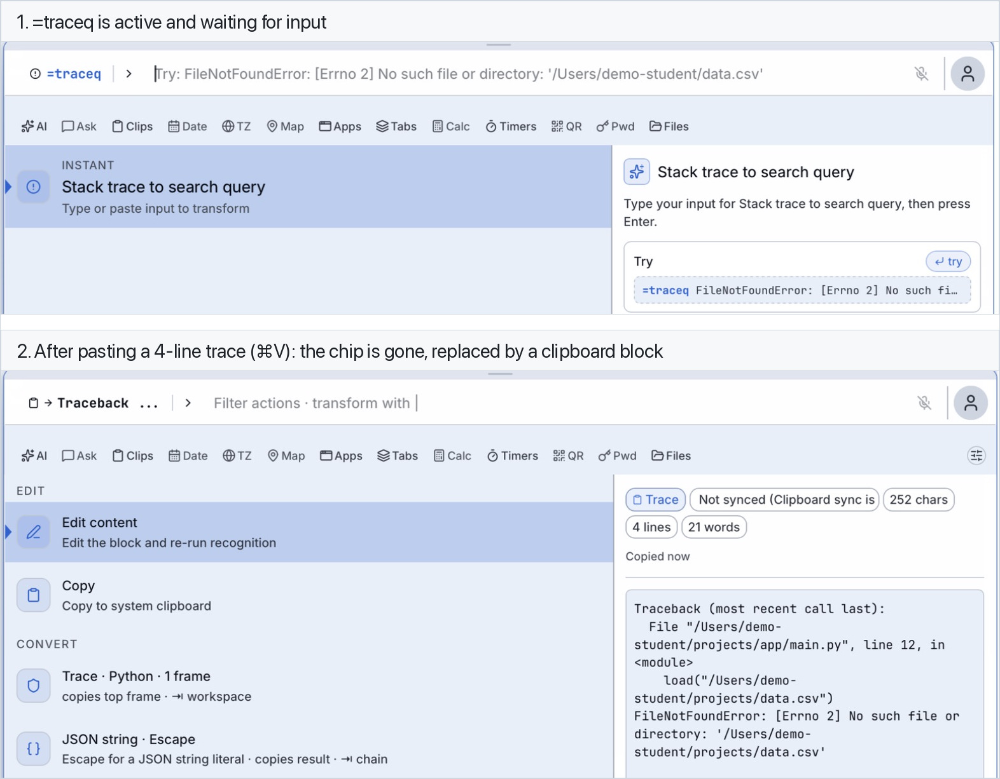
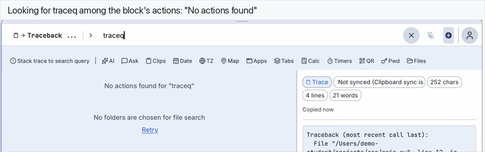
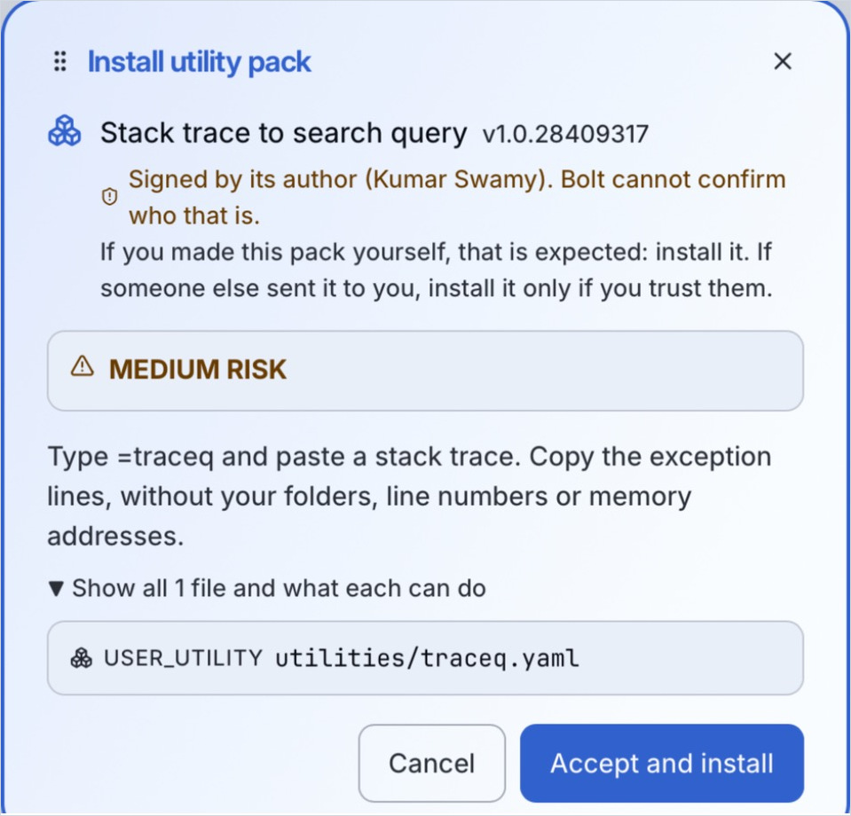
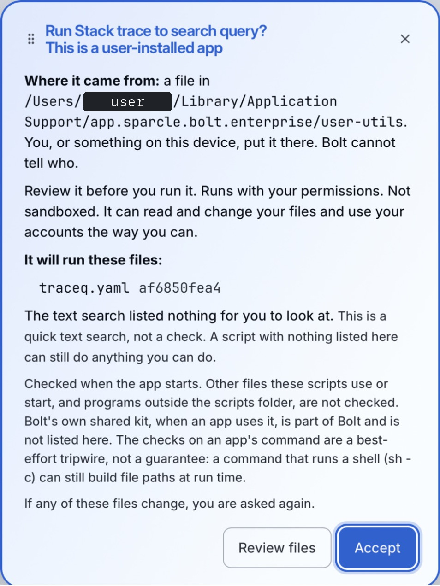
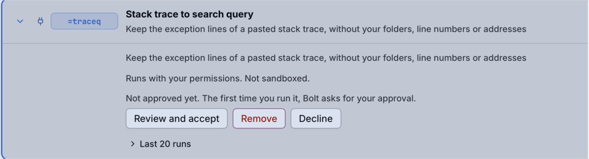
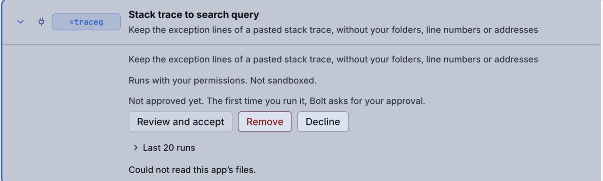
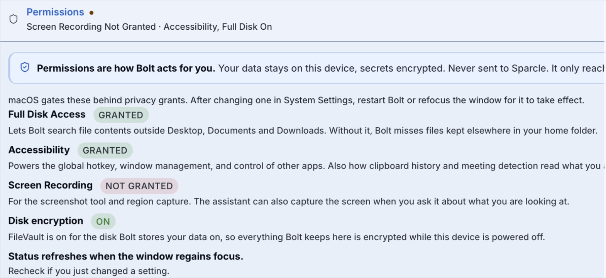

# traceq, and Bolt 0.1.184 findings from a first install

[traceq](app/) is a [Bolt](https://sparcle.app/bolt/) App for student developers. Give it a stack trace and it keeps only the exception lines, dropping folders (which hold your user name), line numbers and memory addresses, so you can search for the error or post it. It is a tier 2 `runtime: transform` app: no command, no network. 19 test cases are in [`app/bolt-app.json`](app/bolt-app.json).

```
in:  FileNotFoundError: [Errno 2] No such file or directory: '/Users/demo-student/projects/data.csv'
out: FileNotFoundError: [Errno 2] No such file or directory: 'data.csv'
```



**Install:** download `traceq-1.0.28409317.boltpack` from [Releases](https://github.com/kumarswamyg2005/traceq/releases/latest). In Bolt, open Settings → Desktop App → User Apps → **Install an app pack** (double-clicking a `.boltpack` does not open Bolt). Then expand traceq there and click Review and accept.

## Findings in Bolt 0.1.184

What I found in Bolt itself while building, installing and reinstalling traceq.

| | Finding | Reproduced |
|---|---|---|
| A1 | A multi-line paste drops the active `=chip`, so transform apps only work on single typed lines | 3 of 3 pastes, 2 installs |
| A2 | Bolt recognizes a pasted stack trace but leaves the `/Users/<name>` path in what you copy | every paste |
| B1 | One tier 2 pack gets four different risk stories (toolkit, install card, settings row, approval dialog) | 3 installs |
| B2 | "Review and accept" fails with "Could not read this app's files" after a pack install, until Bolt restarts | 3 of 3 installs |
| B3 | After Remove and reinstall, the app is missing from the User Apps list until you click Reload | once |
| C1 | Onboarding: the folders step has no skip, and its × jumps from step 2 to step 4 | first launch |
| C2 | The hotkey set up in onboarding fails; a toast asks for Accessibility while Settings shows it granted | first launch |
| C3 | The window-snap grid is drawn over the paste preview | first session |
| C4 | Freeze reports that are probably false (a modal folder picker counted as a 5 s stall) | first session |
| C5 | `.boltpack` is not a registered file type, so double-clicking a shared pack does nothing | Info.plist |

**Setup:** 26 November 2026, macOS 27.2.1 on Apple Silicon, 8 GB RAM. Installer `Bolt-Enterprise-0.1.184-aarch64-apple-darwin.dmg` from sparcle.app/download; its SHA-256 matched the release's `SHA256SUMS`, and the app is signed by Sparcle Inc. (4VSW7NBZ2S) and notarized. A fresh install with no folders granted, explored with Claude Code driving Bolt (clicks and keys through macOS automation) and me checking the results. The paste and approval findings were re-run on a second and third install. Screenshots are full Retina captures, cropped; the only edit is my Mac user name blacked out in one dialog.

## A. Transform apps and pasting

### A1. A multi-line paste drops the `=chip`

With `=traceq` active, pasting a stack trace turns the input into a clipboard block ("📋 → Traceback …") and the chip is gone. The same happens if you type `=traceq ` and then paste. Bolt labels the block "Trace · Python · 1 frame", but its action list does not offer user transform apps: typing `traceq` there gives "No actions found". A single typed line works (top image).





**Why it matters:** transform apps exist to reshape pasted text (csv2md, errors, parse-app-logs, traceq), and the bolt-apps docs describe them as "type `=csv2md` and paste". On 0.1.184 that only works for one typed line. Not tested: other paste shortcuts such as ⇧⌘V.

### A2. Bolt recognizes a trace but does not clean it

The pasted trace is recognized as "Trace · Python", with an action that "copies top frame" (bottom half of the A1 figure). The user name in `/Users/<name>/…` stays in what you copy. That is the gap traceq fills; a natural home for it would be one more action on that built-in Trace recognizer.

## B. Installing and approving a tier 2 pack

### B1. One pack, four risk stories

For the same pack, which runs no command and no script:

1. `bolt-apps ship` said "Expect HIGH risk: it runs a script on your computer". Fixed in [SparcleHQ/bolt-apps#110](https://github.com/SparcleHQ/bolt-apps/pull/110).
2. The install card says **MEDIUM RISK**.
3. The User Apps row then says "Runs with your permissions. Not sandboxed."
4. The approval dialog says it "can read and change your files and use your accounts", and "You, or something on this device, put it there. Bolt cannot tell who."

Bolt installed the file itself from a signed pack, and its log records `signer "Kumar Swamy"`, so it can tell who put it there.

 



### B2. "Review and accept" fails after a pack install

Right after installing a pack, "Review and accept" shows "Could not read this app's files." This happened on all three installs: once only the first click failed, and the other two times every click failed until Bolt was restarted. After a restart the review dialog opens on the first click. Nothing is written to `bolt-startup.log`, which logs the install itself as OK. After Accept, the row still says "Not approved yet. The first time you run it, Bolt asks for your approval", yet traceq runs in the launcher without asking.



### B3. The list goes stale after Remove and reinstall

After removing traceq and installing the same pack again, the log shows `install pack: OK` and the scan loads 50 manifests with 0 errors, but traceq is missing from the User Apps list until you click Reload.

## C. First run

### C1. The folders step has no skip

Onboarding step 2 offers only "Select default folders", which asks for Desktop, Documents, Downloads and Pictures. The page dots do nothing. The × on step 2 does not close the onboarding: it jumps to step 4, and step 3 is never shown.

### C2. The hotkey fails, and two screens disagree about why

Step 1 of onboarding says "Press ⌘ twice" opens Bolt from anywhere. Right after onboarding, a toast said:

> Your summon hotkey DoubleCommand is not working: macOS needs to let Bolt see modifier keys. Grant Accessibility and this shortcut starts working straight away.. Pick another hotkey in Settings.

In the same window, Settings → Permissions shows **Accessibility: GRANTED**. Modifier-key hotkeys may need Input Monitoring rather than Accessibility; not checked. (Small typo in the toast: "straight away..".)



### C3. The window-snap grid is drawn over the paste preview

Once in the first session, with a pasted block open, the window-snap grid for the frontmost app ("Top left … Top-right quarter: The window moves to the top-right quarter") was painted over the stack-trace text in the preview pane. Not seen again after a restart.

### C4. Freeze reports that are probably false

Two "BOLT FREEZE REPORT" files appeared in the first two minutes, each "native-main-thread stalled 5.0s" ([report 1](evidence/C4-freeze-report-1.txt), [report 2](evidence/C4-freeze-report-2.txt)). The second started while onboarding's macOS folder picker was open, and a modal system dialog blocks the main thread by design. Both reports say scheduling drift was near zero, which their own text reads as "something in the app blocked it". Caveat: the machine was under load (load average 21 to 30, memory 80% used).

### C5. `.boltpack` is not a registered file type

`Bolt.app/Contents/Info.plist` has no `CFBundleDocumentTypes`, so double-clicking a pack someone emailed you does not open Bolt. The working paths are dragging it onto the launcher, or Settings → Desktop App → User Apps → **Install an app pack**, which the bolt-apps docs do not mention.

## What worked

- Download, signature check, pack review and install: `install pack: OK`, and the installed file is byte-identical to the source.
- Installing a newer version over an older one, with the same signing key.
- traceq on a typed line (top image), and its "No exception line found…" message for text with no exception. The regex steps I had worried about (lookbehind, and `replace` on an empty result) load and run.

## My own bug, found and fixed

Bolt shows `placeholder_examples` as a clickable "Try" input (`=traceq <example>`). Mine said "paste a stack trace after =traceq", which is not a trace. It is now a real one-line example (visible in the A1 figure), shipped as `traceq-1.0.28409317.boltpack`.
